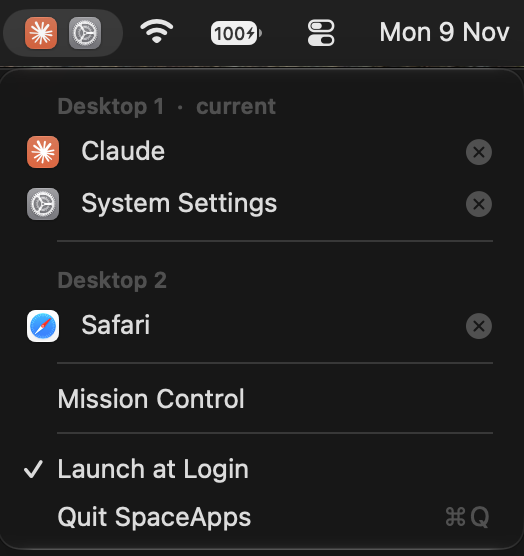

# SpaceApps

A tiny macOS menu bar app that shows which apps are on your current desktop (Space),
and lets you jump to or quit any app on any desktop.



## What it does

- **Menu bar strip:** icons of the apps with windows on the desktop you're on. It updates the
  moment you swipe to another desktop. Up to 8 icons, then `+N`.
- **Click it** for a menu grouped by desktop:
  - **Click an app** to switch to it. If it's on another desktop, macOS takes you there.
  - **Click the ⊗** on the right of a row to quit that app. The menu stays open so you can quit several.
  - Also: Mission Control, Launch at Login, Quit.
- Only windows you can actually see count: hidden, minimized and closed-in-the-background windows
  don't show up.

It needs **no permissions**: no Accessibility, no Screen Recording. It reads only which app owns
each window, never window titles or contents. It uses about 0.2% CPU.

## Requirements

- macOS 26 or later
- Xcode 26 or later (for the Swift 6.2 toolchain), only to build it

## Install

There's no prebuilt download yet (an unsigned app would be blocked by Gatekeeper), so build it:

```bash
git clone https://github.com/artemzhivilo/SpaceApps.git
cd SpaceApps
scripts/build.sh
```

`scripts/build.sh` builds a release version, bundles `SpaceApps.app`, installs it to
`~/Applications` and starts it. Run it again after pulling changes. To start SpaceApps with your
Mac, click it and choose **Launch at Login**.

Checks from the terminal:

```bash
swift run SpaceApps --print    # apps on the current desktop
swift run SpaceApps --spaces   # every desktop's apps, in Mission Control order
swift run SpaceApps --bench    # time per scan (about 2 ms)
```

## How it works

Public macOS APIs can't tell which desktop a window is on, so SpaceApps uses a few private
SkyLight calls, the same family [yabai](https://github.com/koekeishiya/yabai) and
[AltTab](https://github.com/lwouis/alt-tab-macos) rely on:

- `CGSGetActiveSpace` and `CGSCopyManagedDisplaySpaces`: the current desktop and the desktop order.
- `CGSCopySpacesForWindows`: which desktop each window is on.
- `SLSWindowIsOrderedIn`: whether a window is actually shown (minimized and closed windows aren't).

It redraws on macOS's "active Space changed" and app launch/quit/activate notifications, plus a
cheap once-a-second check for windows opening and closing.

Because of the private calls, SpaceApps can't go on the Mac App Store, and a future macOS could
change them. If a call disappears, SpaceApps falls back to "windows on screen" instead of breaking.

## Known limits

- If an app has windows on both your current desktop and another one, clicking it under the other
  desktop keeps you where you are. That's how macOS switches to apps.
- The icons update when macOS announces the desktop switch, at the end of the slide animation.
- Main display only.

## Experiments

`Experiments/` keeps two ideas that didn't make it (swipe tuning, and app icons inside Mission
Control), with notes on what was learned. They aren't built into the app.

## License

[MIT](LICENSE)
